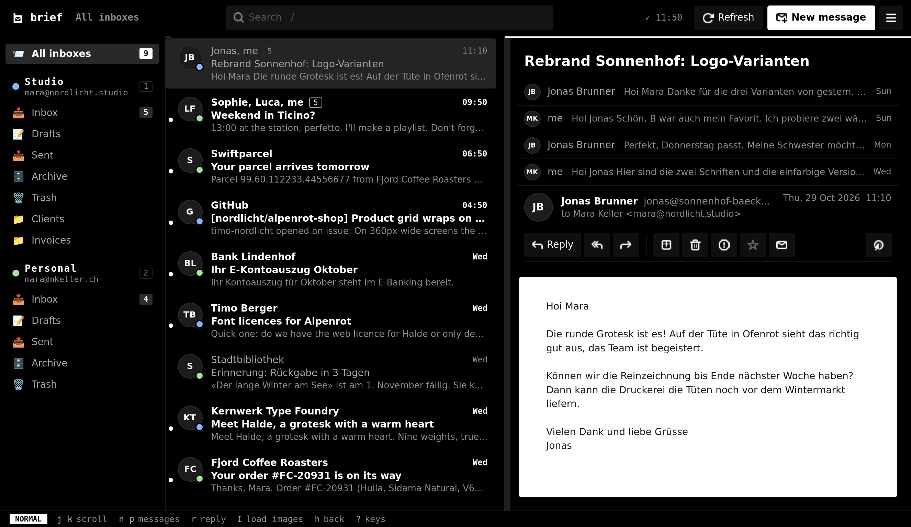
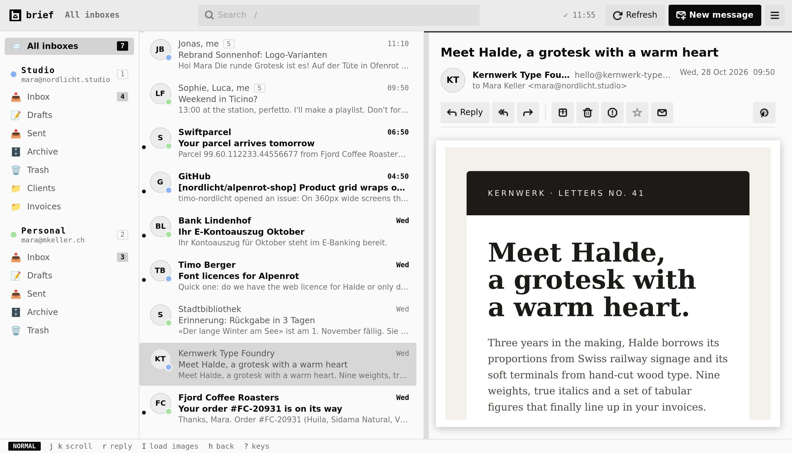
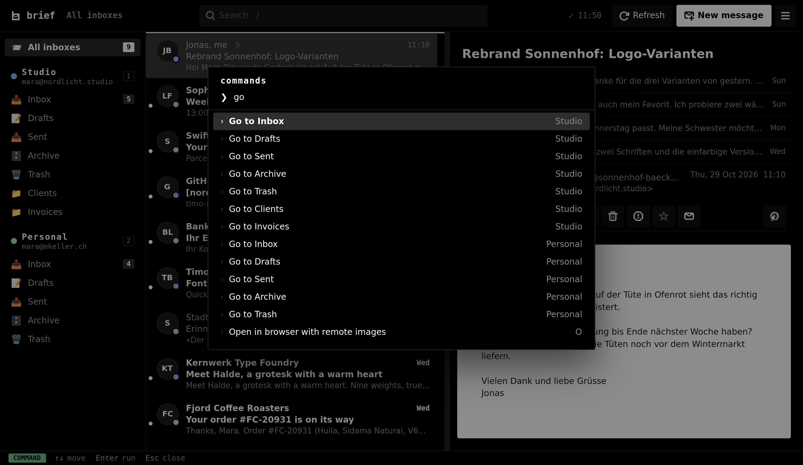
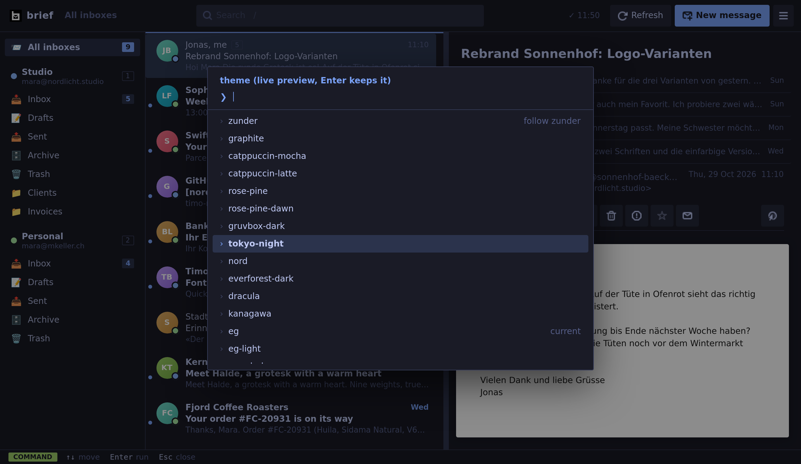
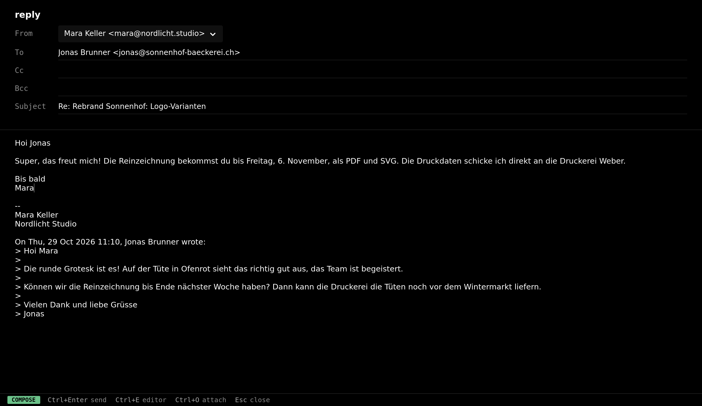

<p align="center">
  <picture>
    <source media="(prefers-color-scheme: dark)" srcset="assets/logo/wordmark-dark.svg">
    
  </picture>
</p>

<p align="center"><b>A keyboard-first mail client for Hyprland.</b> Rust and GTK4, no Electron, no web stack.</p>

Several IMAP/SMTP accounts from different servers in one window, a unified inbox, conversations,
vim-style keys, a command palette, fourteen live-switchable themes and HTML mail rendered with
tracking blocked. It opens instantly because everything is cached locally. Runs on Linux, with a
portable build for Windows.



<table>
  <tr>
    <td></td>
    <td></td>
  </tr>
  <tr>
    <td></td>
    <td></td>
  </tr>
</table>

<sub>Screenshots use made-up accounts and mail.</sub>

## Why

- **Fast.** Headers and recent bodies live in SQLite, so the window opens with your mail
  already there. An incremental sync of two accounts takes about 0.2 s, and new inbox mail
  arrives by IMAP IDLE push.
- **Light.** A 7 MB binary and about 70 MB of RAM with ~2,400 messages cached. WebKit's helper
  processes only start once you open an HTML mail.
- **Keyboard-first.** Every action has a key, `Ctrl+K` finds the rest. The mouse works too.
- **Private.** HTML renders with scripts off, an ephemeral session and a Content Security Policy
  that blocks every remote image, font and stylesheet. A banner says how many were blocked; `I`
  loads them for one mail, **Always for sender** remembers the domain. Links open in your
  browser, never in the view.
- **Conversations.** Replies group into one row, your own answers from Sent included; the
  reader folds the older messages to one line each. `threads = false` turns it off.
- **Works offline.** The newest bodies are prefetched, reading needs no connection.
- **Fits a tiling desktop.** No client-side decorations by default, one window, a second
  `brief` call focuses the running one.

## Install (Arch)

```sh
pacman -S --needed rust gtk4 webkitgtk-6.0
git clone https://github.com/elyesghazel/brief && cd brief
./install.sh   # builds, installs ~/.local/bin/brief, the icon and a desktop entry
```

`install.sh` also makes brief the handler for `mailto:` links, unless another mail app already
has them; then it prints the command to switch:
`xdg-mime default brief.desktop x-scheme-handler/mailto`.

Optional: `ttf-apple-emoji` (AUR). With it installed, brief shows Apple emoji everywhere,
for itself only, through a private fontconfig that hides the other color emoji fonts.

Hyprland bind:

```lua
-- hyprland.lua
hl.bind(mod .. " + SHIFT + M", hl.dsp.exec_cmd("brief"))
```
```ini
# hyprland.conf
bind = $mod SHIFT, M, exec, brief
```

## Install (Windows)

Download `brief-windows-x86_64` from the latest
[build](https://github.com/elyesghazel/brief/actions/workflows/build.yml) (Artifacts), unzip it
anywhere and run `brief.exe`. It is portable: GTK and everything it needs sit in the folder,
nothing gets installed. Config is in `%APPDATA%\brief\config.toml`, the cache in
`%LOCALAPPDATA%\brief\mail.db` (`brief --help` prints both).

What differs from Linux:
- HTML mail shows as text, because WebKitGTK does not exist for Windows. `o` opens the HTML in
  your browser (`O` with remote images).
- Passwords go to the Windows Credential Manager (`brief:<email>`); `password_cmd` runs through
  `cmd`.
- `Ctrl+E` opens `editor` from the config, else `%EDITOR%` in a console window, else Notepad.
- The window has the normal title bar; new-mail notifications are Windows toasts.
- Starting brief again opens a second window instead of focusing the first.

To build it yourself, in an MSYS2 UCRT64 shell:
`pacman -S mingw-w64-ucrt-x86_64-{gtk4,librsvg,adwaita-icon-theme,pkgconf,gcc,rust,ntldd} zip`,
then `cargo build --release && packaging/windows/bundle.sh dist/brief`.
On Linux, `cargo build --no-default-features` builds without WebKit the same way.

## Accounts

Press `A`, type the address and the password. The servers fill in for Gmail, Outlook, iCloud,
Yahoo, Fastmail, GMX, Bluewin, Proton Bridge and Zoho, and fall back to `mail.<domain>`.

- `Ctrl+T` tests the IMAP and SMTP login and lists what happened, without saving anything.
- `Ctrl+Enter` tests again and adds the account.

The password goes into your keyring via `secret-tool` (libsecret), or into
`~/.config/brief/secrets.toml` with mode 0600 when there is none. Gmail, iCloud, Outlook and
Yahoo need an app password.

Or by hand in `~/.config/brief/config.toml` (restart afterwards):

```toml
[[account]]
name = "Work"
email = "me@company.ch"
display_name = "Me"
imap = { host = "mail.company.ch", port = 993, security = "tls" }
smtp = { host = "mail.company.ch", port = 587, security = "starttls" }
password_cmd = "secret-tool lookup service brief account me@company.ch"
signature = "-- \nMe"
color = "#f9e2af"
```

`security` is `tls`, `starttls` or `none`. `password_cmd` can be anything that prints the
password: `pass mail/work`, `rbw get work-mail`, ...

To remove an account: `Ctrl+K` -> **Remove account…**, pick it, confirm with `Enter` or `y`.
brief cuts just that block out of the config, forgets the saved password and drops the cached
mail. The mail on the server stays.

### Gmail and Outlook without app passwords

Gmail and Microsoft accounts (outlook.com, hotmail, live, Microsoft 365) can sign in through the
browser instead (OAuth2, XOAUTH2 for IMAP and SMTP). In the add-account form press `Ctrl+O`
after typing the address; for accounts written by hand run `brief login <name>`. brief keeps the
refresh token in the keyring (or `secrets.toml`) and renews access on its own.

brief has no registered OAuth app yet, so bring your own client id once per provider:

```toml
[oauth.google]
client_id = "1234-abc.apps.googleusercontent.com"
client_secret = "GOCSPX-..."

[oauth.microsoft]
client_id = "00000000-0000-0000-0000-000000000000"

[[account]]
name = "Gmail"
email = "me@gmail.com"
imap = { host = "imap.gmail.com", port = 993, security = "tls" }
smtp = { host = "smtp.gmail.com", port = 465, security = "tls" }
auth = "oauth2"
oauth = { provider = "google" }   # client_id etc. can also go here per account
```

**Google:** in the Google Cloud console create a project, enable the Gmail API, set up the OAuth
consent screen (External, add yourself as a test user, scope `https://mail.google.com/`), then
Credentials -> Create OAuth client ID -> *Desktop app*. Copy the client ID and secret (Google
requires the secret for desktop apps; it is not really secret).

**Microsoft:** in the Azure portal (Entra ID) go to App registrations -> New registration, for
accounts in any organizational directory and personal Microsoft accounts. Under Authentication add
the platform *Mobile and desktop applications* with redirect URI `http://localhost` and turn on
"Allow public client flows". Under API permissions add the delegated `IMAP.AccessAsUser.All`,
`SMTP.Send` and `offline_access`. Copy the Application (client) ID; no secret needed.

## Keys

`?` shows all of them in the app, `Ctrl+K` lists every command.

| Keys | |
|---|---|
| `j` `k` / `J` `K` | next / previous in the pane / row from anywhere |
| `n` `p` | next / previous message in a conversation |
| `h` `l` `Tab` `Enter` | switch pane, read |
| `gg` `G` `Ctrl+d` `Ctrl+u` `Space` | jump, half page, page |
| `0` `1`-`9` `[` `]` | all inboxes, account inbox, previous / next folder |
| `gi` `gs` `gd` `ga` `gt` `gj` | inbox, sent, drafts, archive, trash, spam |
| `/` | search: words, `from:` `to:` `subject:` `is:unread` `is:starred` `has:attachment`; Enter also searches the server |
| `c` `r` `R` `f` | compose, reply, reply all, forward |
| `e` `d` `!` `m` | archive, delete, spam, move |
| `s` `u` `U` | star, read / unread, mark all as read |
| `x` `*` | select, select all |
| `I` | load remote images for this mail |
| `o` `O` `H` `L` `a` | browser, browser with images, HTML / text, links, attachments |
| `Ctrl+=` `Ctrl+-` `Ctrl+0` | zoom the HTML view |
| `Ctrl+R` | fetch new mail on every account |
| `t` | theme picker with live preview |
| `A` | add account |
| mailto: link in a mail, or `L` -> link | write to it in brief's composer |

Composer: `Ctrl+Enter` send, `Ctrl+E` edit in `$EDITOR`, `Ctrl+O` attach, `Ctrl+S` save draft,
`Tab` takes the address suggestion, `Esc` twice discards.

## Themes

`graphite` (default), `catppuccin-mocha`, `catppuccin-latte`, `rose-pine`, `rose-pine-dawn`,
`gruvbox-dark`, `tokyo-night`, `nord`, `everforest-dark`, `dracula`, `kanagawa`, `one-dark`,
and `eg` / `eg-light`: plain black and white with JetBrains Mono for the chrome, after the
[elyesghazel.ch](https://elyesghazel.ch) design kit. `zunder` follows the theme of the zunder
launcher, if you use it.
Press `t` to switch with a live preview; the choice is saved.

Your own: `~/.config/brief/themes/<name>.css` with `@define-color` lines for
`bg fg muted faint ghost accent green sel hover red yellow`. Extra CSS goes in
`~/.config/brief/style.css`.

## Config

`~/.config/brief/config.toml` is written with comments on first start.

| Key | Default | |
|---|---|---|
| `theme` | `"graphite"` | see above |
| `font`, `font_size` | Inter, 10.5 | UI font |
| `html` | `true` | render HTML mail; `false` shows text |
| `favicons` | `"duckduckgo"` | sender icons via DuckDuckGo (the sender sees nothing), `"direct"` from the sender's site, or `"off"` |
| `sync_minutes` | `5` | full sync interval; the inbox is pushed via IDLE anyway |
| `cache_limit` | `1000` | newest messages kept offline per folder |
| `notify` | `true` | desktop notification for new inbox mail |
| `decorations` | `false` | window title bar |
| `editor` | `$TERMINAL -e $EDITOR` | for `Ctrl+E`, e.g. `"kitty -e nvim"` |
| `threads` | `true` | one row per conversation, your Sent replies included; `Ctrl+K` toggles it |

## CLI

```
brief            open (or focus) the window
brief mailto:…   write to a mailto: link, in the running window if there is one
brief login ACC  browser sign-in for an account with auth = "oauth2"
brief sync       sync every account once without a window, print the folders
brief themes     list themes
brief cat x.eml  print a message the way the reader shows it
```

## Notes

- On NVIDIA brief sets `WEBKIT_DISABLE_DMABUF_RENDERER=1` for itself, the usual fix for blank
  WebKit views there.
- The app icon and wordmark are generated from JetBrains Mono outlines by
  `assets/logo/build.py`.

## License

MIT
